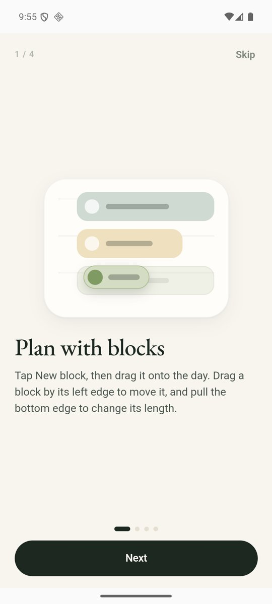
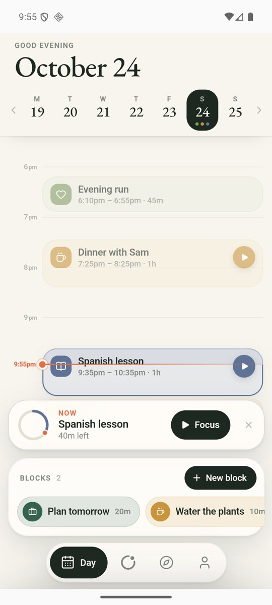
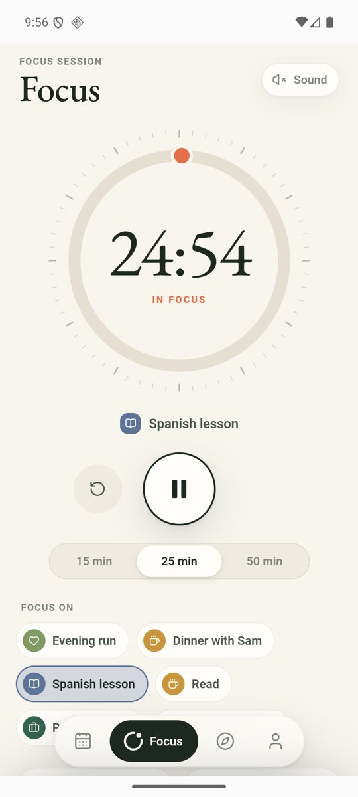
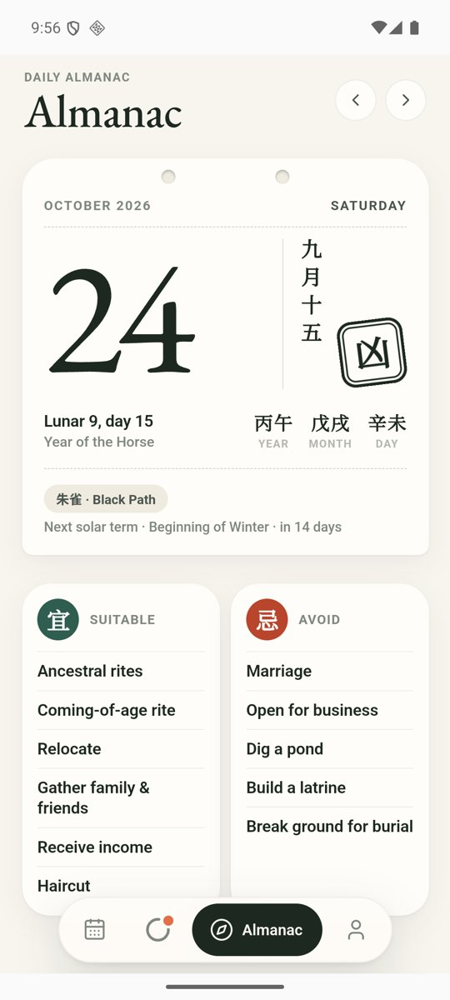
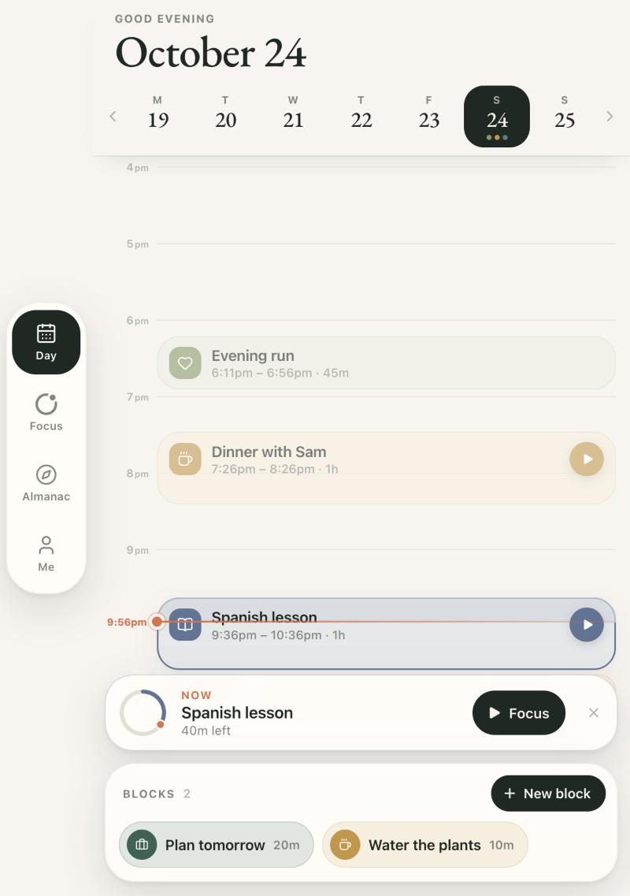
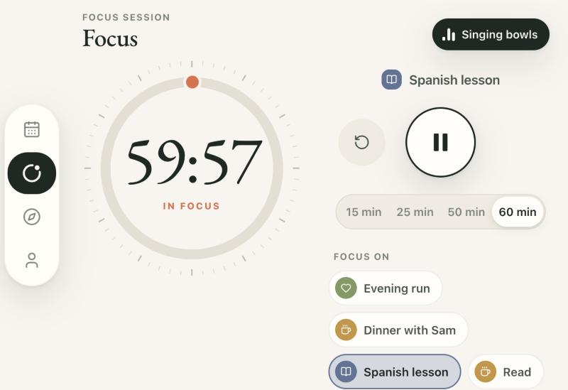
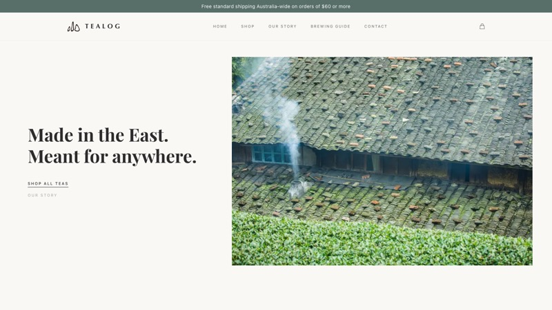
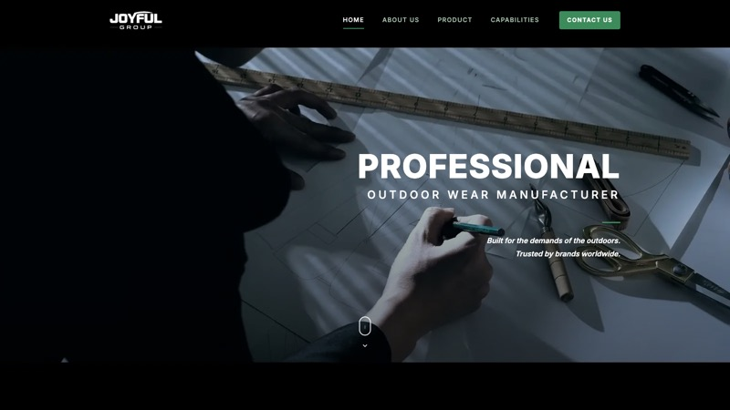

<p align="center">
  <picture>
    <source media="(prefers-color-scheme: dark)" srcset="brand/svg/horizontal-reversed.svg" />
    
  </picture>
</p>

<p align="center">We make our own apps, and build websites and software for businesses.<br/>做自己的应用，也帮你做。</p>
<p align="center"><a href="https://mossyware.com">mossyware.com</a></p>

---

MossyWare is a small software studio. Our day planner Orbit is in beta on iOS and Android, our first game Svalbard Rhapsody is in development, and we build websites and apps for clients.

This repository holds the source of [mossyware.com](https://mossyware.com): a static, bilingual (English / 简体中文) one-page site with no build step and no dependencies.

## Projects

### Orbit: *Plan less. Focus more.*

A day planner for iPhone and Android with time blocks, a focus timer with lo‑fi and singing-bowl sounds generated on the device, and a daily almanac.

<p align="center">
  
  
  
  
</p>

<p align="center"><sub>v0.9.5 · iOS (TestFlight) · Android · English · 简体中文 · 繁體中文</sub></p>

| | |
|---|---|
| **Day** | A timeline of the day. Drag a new block onto it, move it by its edge, resize it from the bottom, drop it back in the tray or the bin. A week strip on top and a one-tap *Focus* nudge when a block is happening now. |
| **Focus** | An orbit-ring countdown driven by wall-clock time, so it stays right in the background. Optional *lo‑fi* and *singing bowl* soundscapes. Every sound is synthesised on the device with the Web Audio API, so nothing is downloaded. |
| **Almanac** | A wall-calendar leaf for each day. In Chinese: 宜 / 忌, the twelve double-hours, solar terms, moon phase with a classical verse and a daily 签. In English: moon phase, sun sign, a tarot card, lucky colour and number. |
| **Reminders** | Local notifications before a block starts and when a focus session ends. |
| **Privacy** | No server, no analytics. Plans live on the device; export a backup, import it elsewhere, or delete the account. |
| **Adaptive layout** | A side rail replaces the tab bar on wide windows (iPhone Duo inner display, Split View, tablets) and in landscape. |

<p align="center">
  
  &nbsp;
  
</p>

Built with React 18, Vite and Capacitor 8 for the native shells; Web Audio for all sound; `lunar-javascript` for the almanac. Orbit's own source is kept private.

### Svalbard Rhapsody · 斯瓦尔巴狂想曲

Our first game, named after the Arctic islands of Svalbard. In development; details to follow.

## Websites and software for clients

We design and build websites and web and mobile apps, then host and maintain them.

| | Client | What we did |
|---|---|---|
| <a href="https://tealog.com.au"></a> | **TEALOG**<br/>[tealog.com.au](https://tealog.com.au) | Online shop for a Melbourne tea brand that sources directly from Fujian. Brand site, catalogue, checkout and brewing guide. |
| <a href="https://joyful-outdoors.com"></a> | **JOYFUL GROUP**<br/>[joyful-outdoors.com](https://joyful-outdoors.com) | Company site for an outdoor-wear OEM / ODM manufacturer with factories in China, Myanmar and Bangladesh. |

Get in touch: [marsli2000@outlook.com](mailto:marsli2000@outlook.com)

## This site

```
index.html      markup, English copy as the default
styles.css      design tokens, layout, animations
main.js         EN / 中文 switch, scroll reveals
assets/         Orbit icon and screenshots, client-site screenshots
brand/          logo kit (see below), favicon.svg, og-image.png
docs/           images for this README
favicon.ico, apple-touch-icon.png, site.webmanifest   browser and home-screen icons
CNAME           custom domain for GitHub Pages
```

Run it by opening `index.html`, or serve the folder:

```bash
python3 -m http.server 8000   # http://localhost:8000
```

**Translations** live in the `STRINGS` table in `main.js`. Every translatable element carries a `data-i18n` key; add the key to both `en` and `zh`. The chosen language is remembered per browser and defaults to the visitor's browser language.

**Deploying:** enable GitHub Pages on `main` (root folder). The `CNAME` file points it at `mossyware.com`; at the DNS provider add the four GitHub Pages `A` records for the apex domain and a `CNAME` for `www` → `marsoriginal.github.io`.

**Secrets:** this repository is public. Keys, `.env` files, keystores and credentials are ignored by `.gitignore`; keep them out of commits.

## Brand

The logo kit lives in [`brand/`](brand); [`brand/README.txt`](brand/README.txt) has the full usage notes and [`brand/board.png`](brand/board.png) shows every variant.

| | |
|---|---|
| Colours | near-black `#1A1A17`, moss `#4A5D3A`, moss on dark `#7A9163`, off-white `#F4F3EE` |
| Type | Geist Medium for the wordmark (SIL OFL 1.1, see `brand/LICENSE-OFL-Geist.txt`) |
| `svg/`, `png/` | mark, small mark, wordmark, horizontal and stacked lockups, each in color / mono / reversed |
| `icon/` | app icons (light, dark), favicons, Apple touch icons |

Use `mark-small-*` below 48 px; the full mark is for 48 px and up. Reversed files go on dark backgrounds.

On the site: the horizontal color lockup sits in the header, the reversed mark in the contact panel, the mono lockup in the footer, and the small mark is the favicon.

---

<sub>Site code: MIT (see [LICENSE](LICENSE)). Orbit, Svalbard Rhapsody, client names and screenshots © their respective owners.</sub>
