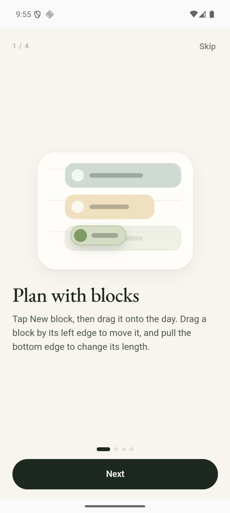
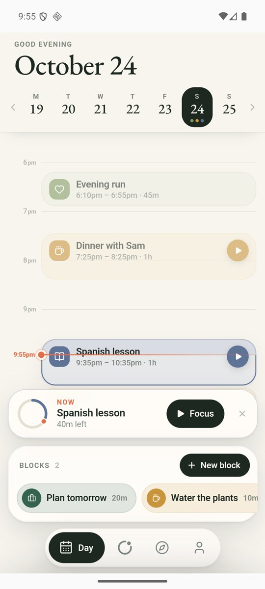
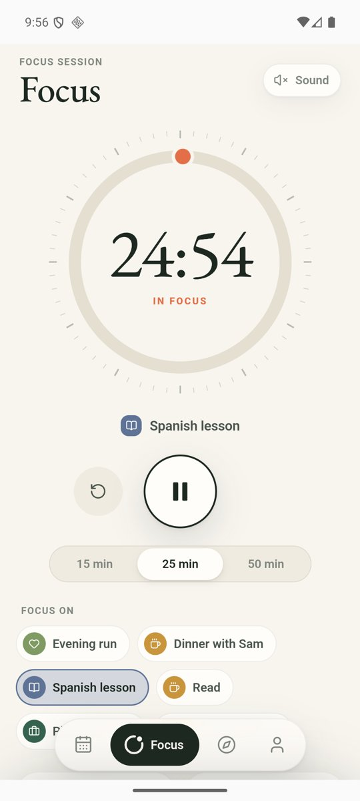
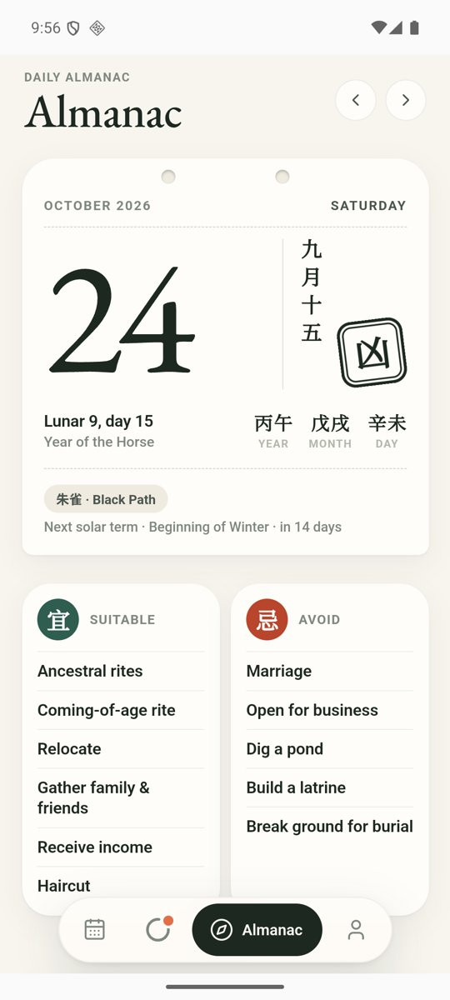
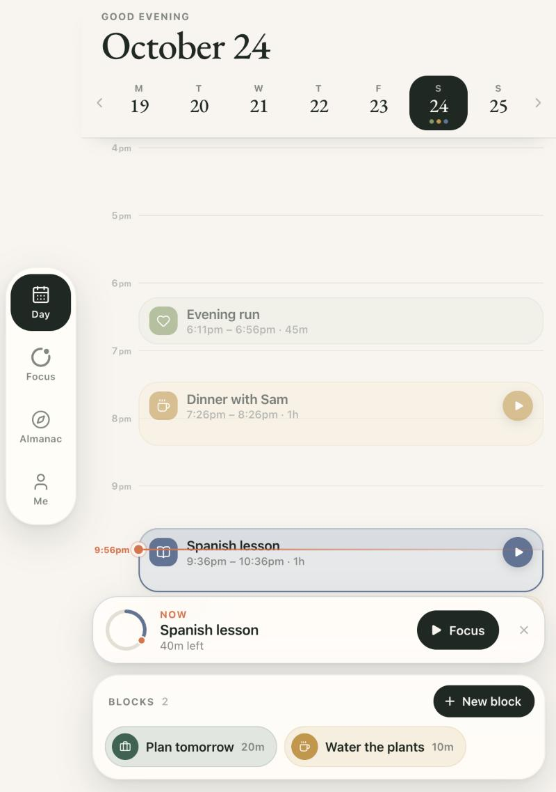
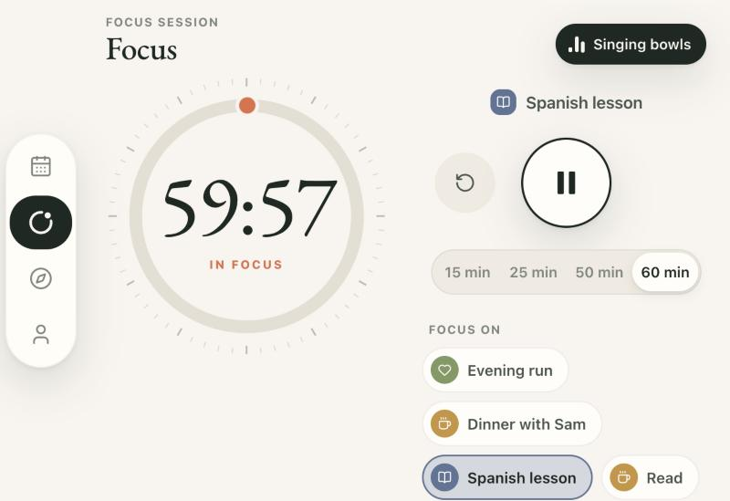
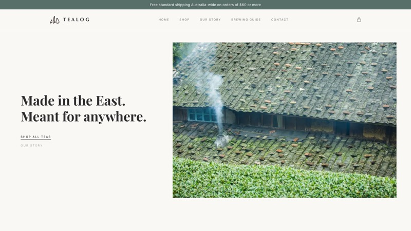

<p align="center">
  
</p>

<h1 align="center">MossyWare</h1>
<p align="center"><b>Small software, grown slowly.</b><br/>小而美的软件，慢慢生长。</p>
<p align="center"><a href="https://mossyware.com">mossyware.com</a></p>

---

MossyWare is an independent software studio. We make calm, carefully crafted apps of our own, and build websites and software for clients.

This repository holds the source of [mossyware.com](https://mossyware.com) — a static, bilingual (English / 简体中文) one-page site with no build step and no dependencies.

## Projects

### Orbit — *Plan less. Focus more.*

A calm day planner for iPhone and Android: time blocks, a focus timer with synthesised lo‑fi and singing bowls, and a daily almanac.

<p align="center">
  
  
  
  
</p>

<p align="center"><sub>v0.9.5 · iOS (TestFlight) · Android · English · 简体中文 · 繁體中文</sub></p>

| | |
|---|---|
| **Day** | A timeline of the day. Drag a new block onto it, move it by its edge, resize it from the bottom, drop it back in the tray or the bin. A week strip on top and a one-tap *Focus* nudge when a block is happening now. |
| **Focus** | An orbit-ring countdown driven by wall-clock time, so it stays right in the background. Optional *lo‑fi* and *singing bowl* soundscapes — every sound is synthesised on the device with the Web Audio API; nothing is downloaded. |
| **Almanac** | A wall-calendar leaf for each day. In Chinese: 宜 / 忌, the twelve double-hours, solar terms, moon phase with a classical verse and a daily 签. In English: moon phase, sun sign, a tarot card, lucky colour and number. |
| **Reminders** | Local notifications before a block starts and when a focus session ends. |
| **Private by design** | No server, no analytics. Plans live on the device; export a backup, import it elsewhere, or delete the account. |
| **Adaptive layout** | A side rail replaces the tab bar on wide windows (iPhone Duo inner display, Split View, tablets) and in landscape. |

<p align="center">
  
  &nbsp;
  
</p>

Built with React 18, Vite and Capacitor 8 for the native shells; Web Audio for all sound; `lunar-javascript` for the almanac. Orbit's own source is kept private.

### Svalbard Rhapsody · 斯瓦尔巴狂想曲

Polar night, midnight sun, and the quiet in between. In development — coming soon.

## Websites & software for clients

We design and build websites, web and mobile apps, and look after hosting and upkeep afterwards.

| | Client | What we did |
|---|---|---|
| <a href="https://tealog.com.au"></a> | **TEALOG**<br/>[tealog.com.au](https://tealog.com.au) | A Melbourne shop for Chinese teas sourced direct from Fujian — brand site, catalogue, checkout and a brewing guide. |
| <a href="https://joyful-outdoors.com"></a> | **JOYFUL GROUP**<br/>[joyful-outdoors.com](https://joyful-outdoors.com) | Company site for an outdoor-wear OEM / ODM manufacturer with factories in China, Myanmar and Bangladesh. |

Get in touch: [marsli2000@outlook.com](mailto:marsli2000@outlook.com)

## This site

```
index.html      markup, English copy as the default
styles.css      design tokens, layout, animations
main.js         EN / 中文 switch, scroll reveals
assets/         favicon, Orbit icon and screenshots, client-site screenshots
docs/           images for this README
CNAME           custom domain for GitHub Pages
```

Run it by opening `index.html`, or serve the folder:

```bash
python3 -m http.server 8000   # http://localhost:8000
```

**Translations** live in the `STRINGS` table in `main.js`. Every translatable element carries a `data-i18n` key; add the key to both `en` and `zh`. The chosen language is remembered per browser and defaults to the visitor's browser language.

**Deploying** — enable GitHub Pages on `main` (root folder). The `CNAME` file points it at `mossyware.com`; at the DNS provider add the four GitHub Pages `A` records for the apex domain and a `CNAME` for `www` → `marsoriginal.github.io`.

**Secrets** — this repository is public. Keys, `.env` files, keystores and credentials are ignored by `.gitignore`; keep them out of commits.

---

<sub>Site code: MIT (see [LICENSE](LICENSE)). Orbit, Svalbard Rhapsody, client names and screenshots © their respective owners.</sub>
